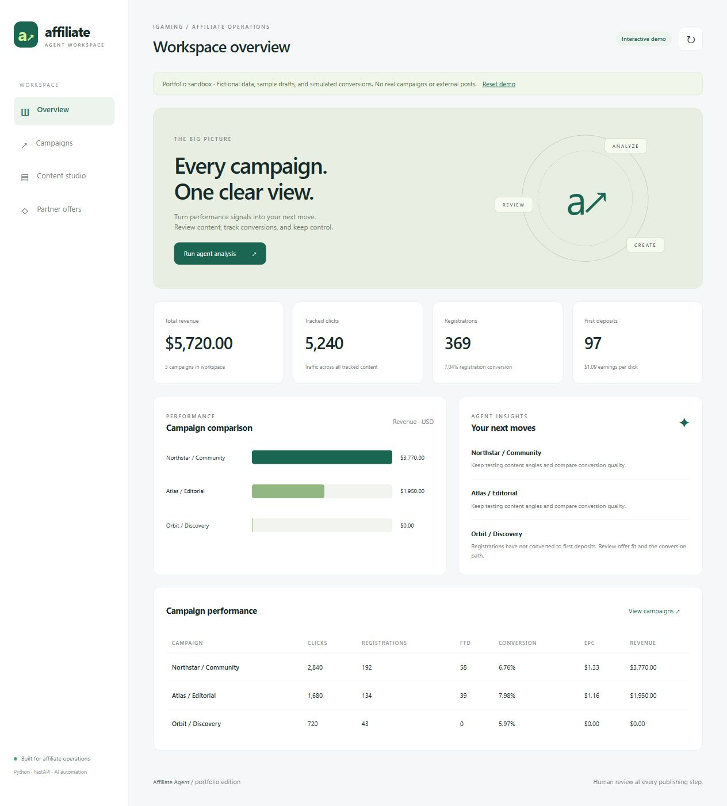
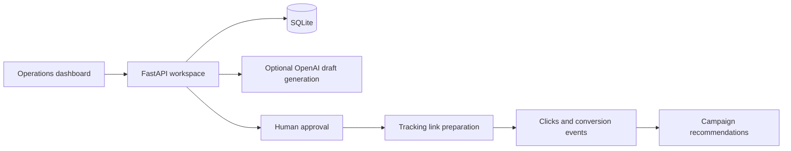

# iGaming Affiliate Agent

**An affiliate operations workspace that turns campaign signals into reviewed content and trackable partner links.**

[Try the interactive demo](https://wiyadadev.github.io/iGaming-Affiliate-Agent/) · [Explore the backend](backend) · [Workflow tests](tests/test_workflow.py)



## The problem

Affiliate teams often manage partner offers, campaign results, draft content, and conversion links in separate tools. This project brings those steps into one workspace, with a human review gate before a draft becomes ready for distribution.

## What you can do

- Add partner offers, payout terms and affiliate destinations.
- Create campaigns for Telegram, editorial or social channels.
- Review clicks, registrations, first deposits, conversion rate, revenue and earnings per click.
- Generate a draft with OpenAI, or write a manual draft without API credentials.
- Approve or reject drafts, then prepare a unique tracking link.
- Record conversion events and see updated campaign recommendations.
- Run an optional background agent cycle that creates drafts for active campaigns.

**The public demo is a sandbox:** all brands and performance figures are fictional. Draft generation uses local sample templates; conversions are simulated. Nothing is posted to Telegram and no AI API key is exposed. Changes reset when the page reloads.

The Python workspace uses real database-backed CRUD and tracking. “Prepare tracking link” records the content as ready and creates a redirect link; it does **not** deliver a post to an external channel. Optional Telegram delivery has a separate endpoint and configuration.

## Try the demo

1. Open **Content studio** and approve the sample draft.
2. Select **Prepare tracking link**.
3. Select **Simulate conversion**, then return to **Overview** to see updated metrics.
4. Try adding your own offer, campaign and draft. **Reset demo** restores the sample data.

## Run the Python workspace

Requires Python 3.12+.

```powershell
python -m venv .venv
.\.venv\Scripts\python.exe -m pip install -r requirements.txt
Copy-Item .env.example .env
.\.venv\Scripts\python.exe -m uvicorn main:app --app-dir backend --host 127.0.0.1 --port 8000
```

On macOS/Linux, use `python3` and `.venv/bin/python` instead.

Open <http://127.0.0.1:8000/dashboard/>. The workspace starts with an empty SQLite database unless an existing `backend/igaming.db` is present. Add an offer and an **active** campaign, then create a draft. Existing workspace records are preserved; no seed script overwrites your database.

AI generation is optional. Configure `OPENAI_API_KEY` and a model your account can access using `OPENAI_MODEL`. Without a key, the dashboard and manual content workflow remain available; AI requests return a clear configuration message.

To preview the sandbox through the Python server, open `/dashboard/?demo=1`. To run only the static demo, serve `frontend` with a static server or open `frontend/index.html` in a browser.

## Architecture



- **Frontend:** responsive HTML, CSS and JavaScript, with no build step.
- **Backend:** FastAPI, Pydantic validation, SQLAlchemy and SQLite.
- **AI:** lazy provider initialization, configurable model and language, drafts saved for review.
- **Tracking:** redirect links, conversion event endpoints and campaign aggregates.
- **Automation:** optional in-process scheduler; disabled until explicitly started.
- **Delivery:** optional Telegram integration, separate from portfolio simulation.

## Verification

```powershell
.\.venv\Scripts\python.exe -m pytest tests -q
node --check frontend/app.js
```

Tests use a disposable database. They cover startup without AI credentials, approval and publishing rules, repeatable link preparation, conversion metrics, validation, orphan record prevention, token protection, language selection, and paused campaign exclusion. AI calls are mocked in tests; real provider billing and Telegram delivery are not tested.

## Deployment boundaries

GitHub Pages hosts only the interactive static demo. Enable **Settings → Pages → Source: GitHub Actions** to use the included workflow. The backend and real database are not published to Pages.

The Python service defaults to localhost. Before exposing it on a server, set `ADMIN_TOKEN`, use HTTPS, and enter that token with the dashboard's **Access token** button. Protected APIs require `Authorization: Bearer <token>`; health, dashboard assets and click redirects remain public. Conversion callbacks require this same token. Add provider-specific signature verification and event deduplication before integrating a live partner callback. SQLite should be backed up regularly.

The scheduler is in-process and intended for a single server worker. The scoring rules are transparent heuristics, not a trained predictive model or proof of campaign profitability. There is no multi-user authentication, billing system, or live advertising integration in this portfolio edition.

`.env`, API credentials, local databases, virtual environments and backups are excluded from Git. The repository contains source code, tests and fictional portfolio assets only.
